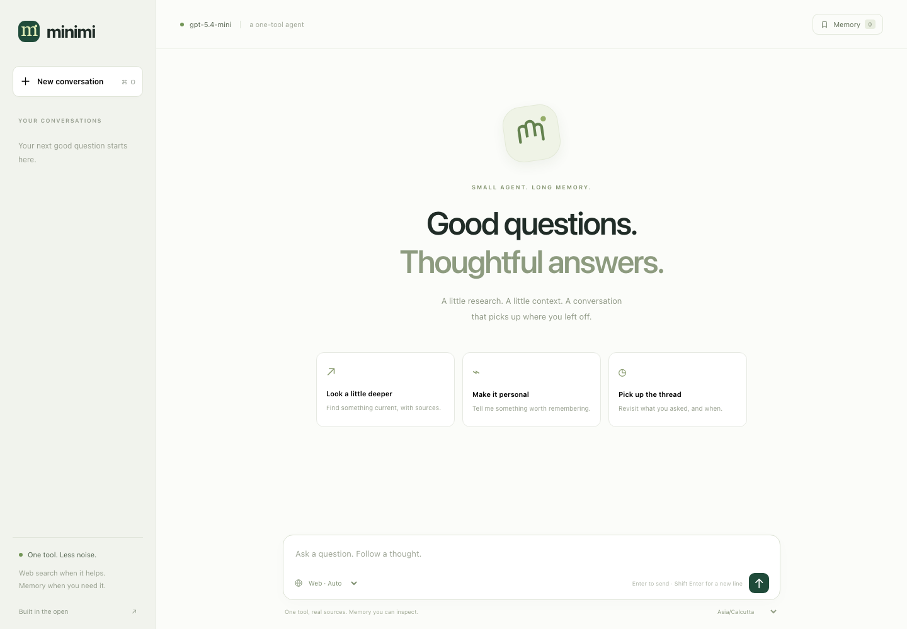
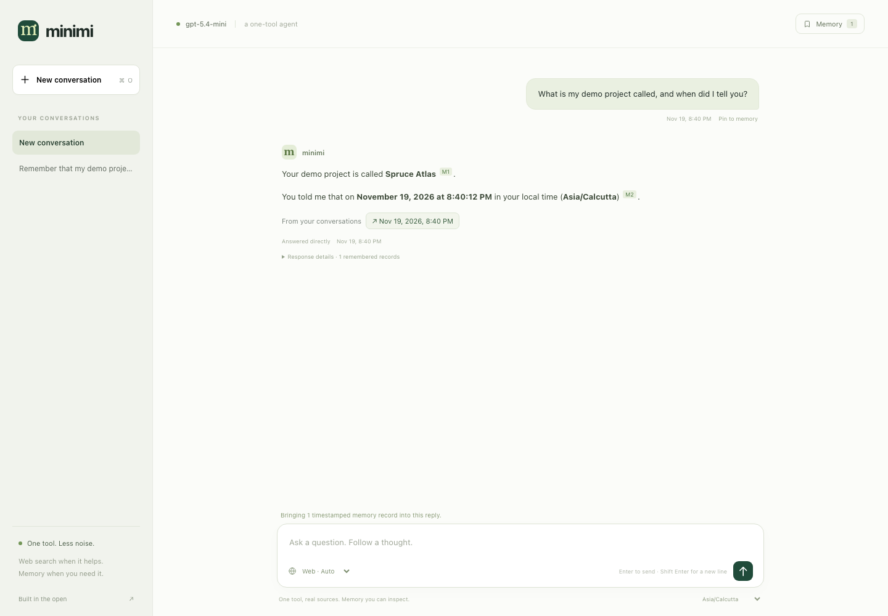

# Minimi

A chat agent with **one tool—web search**—and a timestamped memory you can inspect.

**[Design and tradeoffs](design.md)** · [Live evaluation](evaluation/live-results.json) · [Browser checks](evaluation/browser-results.json)



Minimi answers directly when it can, searches for changing facts, and streams its response. Web answers include clickable source citations. Each response has a details panel showing search activity, the model, timing, token usage and retrieved memory.

Conversations persist across reloads. Within the same browser workspace, the agent can recall earlier chats and answer questions such as “What did I ask yesterday?” using server-recorded timestamps and your selected timezone. A memory notebook lets you inspect questions, pin important context, filter by date, export history and delete it. Start a message with “Remember that…” to pin it automatically. Use the trash icon beside a sidebar conversation to delete that chat, its pins and its semantic index; clearing all history is available in the Memory panel. Memory combines keyword matching, semantic similarity, recent history and pins. Paraphrases can match even without shared words. Click a memory citation to jump to the original message and timestamp. Recall remains bounded; the agent does not see every stored conversation at once.



## Run locally

Requires Python 3.11+ (3.12 recommended) and an OpenAI API key with access to the Responses API and web search. API usage is billed separately from ChatGPT Plus.

```sh
git clone https://github.com/Uday-sidagana/chat-minimi.git
cd chat-minimi
python3.12 -m venv .venv
source .venv/bin/activate
pip install -e '.[dev]'
cp .env.example .env
```

Set `OPENAI_API_KEY` in `.env`, then:

```sh
minimi --port 8010
```

Open **http://127.0.0.1:8010**. The default model is `gpt-5.4-mini`, with reasoning effort `none`. Change `OPENAI_MODEL` and `REASONING_EFFORT` together if your model supports different settings. There is no simulated-answer fallback: a missing key or provider error is reported explicitly.

Local data is stored in `.data/minimi.sqlite`. `.env` and `.data/` are ignored by Git. No Node build, Docker or external database is required locally.

## Try it

Open **Quick guide** in the app header for a six-step walkthrough with ready-to-use prompts. Prompts are prepared for review, never sent automatically.

1. Say: “Remember that my project is called Paper Kite.”
2. Start a new chat: “What is my project called, and when did I tell you?”
3. Click the **M1** citation to open the original message. The highlighted source shows exactly what you said and when.
4. Ask: “Find the latest Python release. Cite python.org and include its release date.” Then follow up: “What about Node.js?” Inspect search activity and sources.
5. Ask: “What did I ask today?” Then open the memory notebook to check the original wording and timestamps.

For a paraphrase demo, tell it “I'm relocating to Bengaluru next spring,” then ask in a new chat “Which city am I moving to?” No explicit pin is needed.

The interface starts empty. Demonstration history is not planted in the application.

## Verification

```sh
pytest -q
# Optional: twelve real, paid model/search requests plus embedding calls; overwrites the snapshot.
python scripts/evaluate.py --live
```

The committed live smoke run covers **12 authored cases**: direct answers, cross-chat and dated recall, corrections, missing personal facts, buried paraphrases, unpinned names, ambiguous dates, historical prompt injection, live search and a contextual web follow-up. See [evaluation notes](evaluation/README.md) for measured latency, manual review and limitations. These are single local samples, not a general accuracy benchmark or latency guarantee. Full responses, checks and usage are in the evaluation JSON.

The browser check exercised real chat, cross-chat memory, reload persistence, workspace isolation, safe Markdown rendering, Unicode citations, clickable memory references and a 390 px mobile layout, with no JavaScript errors. To repeat it with Node 20+ and the app running:

```sh
npm install --prefix runs/browser-check playwright@1.58.2
runs/browser-check/node_modules/.bin/playwright install chromium
node scripts/browser-check.cjs --live
```

GitHub Actions also runs a real Postgres persistence/isolation contract test. Locally, that test is skipped unless `POSTGRES_TEST_URL` points to a disposable database where the test may create and remove a schema. The remaining tests need no API key.

## Deploy on Vercel

1. Create a dedicated Neon project named `chat-minimi`. In **Connect**, enable **Connection pooling** and copy the Postgres connection string, retaining `sslmode=require`. Pick a database region near your Vercel function region. See [Neon's pooling guide](https://neon.com/docs/connect/connection-pooling).
2. In [Vercel New Project](https://vercel.com/new), import `Uday-sidagana/chat-minimi`, branch **main**. Use these settings:

| Setting | Value |
| --- | --- |
| Project name | `chat-minimi` (or an available name) |
| Framework preset | **FastAPI** |
| Root directory | `./` |
| Build command | Leave override off / default |
| Output directory | Leave override off / default |
| Install command | Leave override off / default |

Python 3.12, dependencies, static assets and the streaming function configuration are supplied by the repository. No Docker, frontend build or separate backend service is needed. See [Vercel's FastAPI guide](https://vercel.com/docs/frameworks/backend/fastapi).

3. Add these variables in Vercel. Set secrets directly in the dashboard, not in GitHub or a chat message:

| Variable | Value | Required? |
| --- | --- | --- |
| `OPENAI_API_KEY` | Your OpenAI API key | Yes |
| `DATABASE_URL` | Your dedicated Neon pooled connection string | Yes |
| `MAX_DAILY_TURNS` | `100` for an initial reviewer demo | Optional; app default is 200 |
| `OPENAI_MODEL` | `gpt-5.4-mini` | Optional; already the default |
| `REASONING_EFFORT` | `none` | Optional; already the default |
| `SEMANTIC_MEMORY` | `true` | Optional; already the default |
| `EMBEDDING_MODEL` | `text-embedding-3-small` | Optional; already the default |
| `DEMO_PASSWORD` | A shared password; login username is `reviewer` | Optional |

Add the variables to **Production**. If you also enable Preview deployments, use a separate Neon branch/database for Preview. Environment changes require a redeploy. Do not set `VERCEL` manually; the platform supplies it.

4. Click **Deploy**. The application creates its tables on first use. Hosted mode requires Postgres and reads only deployment environment variables, never a bundled `.env`. Local SQLite data does not migrate automatically.
5. Verify the deployed site: open **Quick guide**, send a message, reload to check persistence, start a new chat to test recall, run a web search and inspect its citations, then try deleting a disposable test chat. `/healthz` reports the model and storage configuration; opening the app also exercises the actual database connection through `/api/session`.
6. Ensure the production URL is accessible to reviewers. If Vercel deployment protection or `DEMO_PASSWORD` is enabled, give reviewers the corresponding access. Copy the working URL into the submission.

The runtime bundle excludes tests, screenshots, evaluation data, browser tooling, local state and secrets. These supporting materials remain in GitHub where useful for the challenge. The configuration is ready for deployment; a live deployment still needs the Vercel project and database credentials.

Memory is server-side, scoped to an opaque browser cookie; clearing that cookie loses access to its workspace. Selected history and the question are sent to OpenAI. Semantic retrieval also sends bounded text batches to the embedding API; embeddings are saved in the same database and deleted with their source messages. It is host-managed retrieval, not a second agent tool. Use the notebook to export or delete application history. See [design.md](design.md) for privacy, limits and failure handling.
