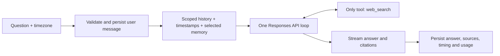

# Minimi: one-tool chat, with time-aware memory

## Goal

Answer quickly, use web evidence when facts may have changed, and remember what the user asked and when. The implementation deliberately uses one model loop and exactly one model-visible tool: OpenAI's hosted `web_search`. Memory is ordinary application storage and host-side context construction, not another agent tool.

## Request path

FastAPI serves the UI and streaming API. SQLite is the local default; Postgres is the persistent hosted backend. The browser uses an opaque, HttpOnly workspace cookie. Every conversation, message, recall and export query is scoped to that workspace. No account, vector database, embedding model, summarization agent, scheduler or orchestration framework is required.

## Fast answers

The default is `gpt-5.4-mini` with reasoning effort `none`. One inference loop avoids a planner, retrieval round trip, verifier model and answer-rewrite waterfall. Token deltas stream immediately; the interface reports measured time to first text and total generation time.

A small host routing policy requires search for explicit freshness requests, leaves ordinary requests in automatic mode and disables search for personal-history recall unless external verification is requested. The user can choose automatic, always-search or off; private recall still bypasses forced search. The model is instructed to search uncertain or niche external facts even when a freshness keyword is absent. This is a heuristic, not a perfect classifier.

Requests allow at most two search-tool calls and 2,400 output tokens. The application deadline is 110 seconds; the Vercel function configuration allows 180 seconds. There are no automatic paid retries or cached answers to changing facts. Provider prompt-cache hits may occur, but correctness does not depend on them.

## Correctness and web evidence

The prompt asks for primary sources, concise answers, relevant dates, inline citations and explicit uncertainty. Only actual provider citation annotations become source links; the application does not invent citations from arbitrary generated URLs. Unsafe link schemes and raw HTML are blocked in the renderer. Unicode citation offsets are treated as code points, rather than JavaScript UTF-16 units.

Search calls, their completion status and citations are saved with the response. When search was required, a response without a completed search is rejected as unverified. Tool errors and interrupted output are visible. The app never substitutes a canned answer for an API failure.

Citation presence does not establish that a claim is entailed by a source. There is no independent fact-checking model. Web content and past messages are untrusted data; instructions tell the agent to ignore embedded instructions, distinguish user claims from verified external facts and acknowledge insufficient evidence. Prompt-injection resistance is incomplete, but the agent has no execution, credential-access or messaging tools to misuse.

## Remembering what and when

Every accepted question receives an immutable server UTC timestamp and the user's selected IANA timezone. Relative-date windows use that timezone, including daylight-saving boundaries. Supported windows include today, yesterday, this/last calendar week, last weekday, last N calendar days and an ISO date. Ambiguous ranges are not silently guessed. The model also receives the trusted current UTC/local clock.

For each answer the host supplies:

- Up to 15 completed recent messages from the active chat, including the current question. Whole older messages are removed when the content budget is exceeded; the latest question stays intact.
- Up to six lexical matches from historical user messages across this workspace, or up to 20 records for a supported date-window recall request.
- Up to six latest pinned user messages, deduplicated against the other context.

Historical excerpts are capped at 1,600 characters and include message ID, original chat, exact UTC timestamp, original timezone, local display time and a truncation flag. Recent content has a 36,000-character target after retrieved excerpts are accounted for; metadata and instructions add overhead. A large date-window result plus pins can consume that target, so it is not a hard cap on the entire request. Total match counts disclose when the model has only a subset of dated history.

Retrieval uses parameterized SQL lexical matching, recency and explicit pins. It is cheap, deterministic and inspectable, but can miss paraphrases, indirect references or an older unpinned fact with no shared words. The agent must say it cannot find a memory rather than invent one. The complete stored history remains accessible through the notebook; the model never receives unlimited history. Newer explicit corrections take precedence in the prompt; contradictions remain stored rather than silently rewriting past messages.

“Remember that…” pins the original utterance automatically. Manual pin/unpin controls are also available. These are application features, not model tools. Chat text asking for deletion cannot delete storage: the agent directs the user to the actual delete control. This project uses contextual memory, not fine-tuning or automated training.

## Persistence, failure and retries

The user message and assistant placeholder are persisted before generation. Streaming output is checkpointed roughly once a second. Successful completion stores the canonical answer, actual source annotations, search records, model, token usage, timing and supplied memory. Interrupted or failed partial answers retain an explicit non-completed status and are excluded from future completed-answer context.

Client-generated request UUIDs are bound to a fingerprint of conversation, text, timezone and search mode. Replaying the same accepted request reuses the persisted result instead of charging for another model call; reusing an ID with different content is a conflict. One generation per conversation, a workspace request limit, a global concurrent-request limit and a global daily accepted-turn budget constrain accidental spend. Leases expire interrupted requests without automatically launching another paid inference. Deleting history prevents a late response from resurrecting deleted messages.

Server-sent events run inside the request, with heartbeat comments while waiting. There is no claim of durable background execution after serverless termination. Postgres is mandatory in the hosted environment; silent ephemeral-storage fallback is deliberately disallowed. CI exercises the real Postgres adapter as well as the local SQLite implementation.

## Privacy and access

Messages live on the server, not only in the browser. The model receives the latest question and selected workspace context. OpenAI requests use `store=False`; this is not a promise of zero provider retention. Deployment operators must consider their provider's applicable data policy.

Workspace identifiers are random secrets stored as hashes server-side. Cookies are HttpOnly, SameSite=Lax and Secure when hosted. Write requests reject cross-site origins. API responses disable caching; the interface has a self-only content security policy, no remote fonts or analytics, and locally vendored Markdown rendering with its license. Export and delete controls operate on the current workspace. Export currently enumerates the latest 100 conversations; stored older conversations are not automatically erased. The global daily usage counter survives deletion without retaining message text.

Cookie workspaces provide browser isolation, not verified identity or cross-device accounts. Clearing cookies loses access. Optional shared HTTP Basic access (`reviewer` and `DEMO_PASSWORD`) protects a reviewer deployment but is not a production account system. Internet-scale abuse controls, distributed tenant quotas, account recovery and managed backup retention are outside this challenge implementation. Run behind TLS when hosted.

## Evidence and tradeoffs

`evaluation/live-results.json` records a six-case, one-sample-per-case live run, including complete responses, usage, actual model snapshot and timing. All automated phrase/date/source checks passed. Manual inspection found the missing-memory response acknowledged absent history, and the web response cited the official Python source page. These authored smoke checks do not establish general factual accuracy or citation entailment.

Observed time to first text: median 1.29 seconds, mean 2.22 seconds, maximum 5.44 seconds. Total time averaged 2.56 seconds. The web case made one completed search and took 3.99 seconds total. These measurements are local and provider dependent; there is no claimed service-level guarantee.

`evaluation/browser-results.json` records real browser checks of live chat, cross-chat recall, persistence, workspace isolation, safe Markdown, Unicode citations and mobile width. Unit/API tests cover date windows including DST, access isolation, replay/conflicts, deletion, limits, provider failures and exactly-one-tool configuration. GitHub Actions adds a disposable Postgres contract test. Fake agents are limited to tests; the product requires real provider credentials.

Potential next work would be a larger adversarial benchmark with independently checked source entailment, better semantic recall while preserving timestamp provenance, and authenticated cross-device workspaces. Those would be justified by measured misses rather than added to the critical path in advance.
