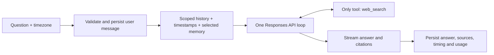

# Minimi: one-tool chat, with time-aware memory

## Goal

Answer quickly, use web evidence when facts may have changed, and remember what the user asked and when. The implementation deliberately uses one model loop and exactly one model-visible tool: OpenAI's hosted `web_search`. Memory is ordinary application storage and host-side context construction, not another agent tool.

## Request path

FastAPI serves the UI and streaming API. SQLite is the local default; Postgres is the persistent hosted backend. The browser uses an opaque, HttpOnly workspace cookie. Every conversation, message, recall and export query is scoped to that workspace. No account system, external vector database, summarization agent, scheduler or orchestration framework is required. The host uses an optional embedding API for retrieval, but the model-visible tool list remains exactly `web_search`.

## Fast answers

The default is `gpt-5.4-mini` with reasoning effort `none`. One conversational inference loop avoids a planner, verifier model and answer-rewrite waterfall. Host-side semantic retrieval adds a bounded embedding round trip when historical candidates exist; date-window lookup bypasses it. Token deltas stream immediately; the interface reports measured time to first text and total generation time.

A small host routing policy requires search for explicit freshness requests, leaves ordinary requests in automatic mode and disables search for personal-history recall unless external verification is requested. The user can choose automatic, always-search or off; private recall still bypasses forced search. The model is instructed to search uncertain or niche external facts even when a freshness keyword is absent. Short follow-ups such as “What about India?” inherit required-search routing when the previous completed answer used search. The model receives the conversation and is instructed to form a self-contained query; there is no extra rewrite-model call. This is a heuristic, not a perfect classifier.

Explicit web-verification requests use low reasoning effort, medium search context and up to four tool calls, allowing a source cross-check. Ordinary requests retain the configured reasoning effort (default none), low search context and a two-call cap. Both paths allow 2,400 output tokens. Generation has a 110-second deadline; semantic API lookup separately has a 2.5-second deadline. Database time adds overhead. The Vercel function configuration allows 180 seconds; there are no automatic paid retries or cached answers to changing facts. Provider prompt-cache hits may occur, but correctness does not depend on them.

## Correctness and web evidence

The prompt asks for primary sources, concise answers, relevant dates, inline citations and explicit uncertainty. Only actual provider citation annotations become source links; the application does not invent citations from arbitrary generated URLs. Unsafe link schemes and raw HTML are blocked in the renderer. Unicode citation offsets are treated as code points, rather than JavaScript UTF-16 units.

Search calls, their completion status and citations are saved with the response. When search was required, a response without a completed search is rejected as unverified. Tool errors and interrupted output are visible. The app never substitutes a canned answer for an API failure.

Citation presence does not establish that a claim is entailed by a source. There is no independent fact-checking model. Web content and past messages are untrusted data; instructions tell the agent to ignore embedded instructions, distinguish user claims from verified external facts and acknowledge insufficient evidence. Prompt-injection resistance is incomplete, but the agent has no execution, credential-access or messaging tools to misuse.

## Remembering what and when

Every accepted question receives an immutable server UTC timestamp and the user's selected IANA timezone. Relative-date windows use that timezone, including daylight-saving boundaries. Supported windows include today, yesterday, this/last calendar week, last weekday, last N calendar days and an ISO date. Ambiguous ranges are not silently guessed. The model also receives the trusted current UTC/local clock.

For each answer the host supplies:

- Up to 15 completed recent messages from the active chat, including the current question. Whole older messages are removed when the content budget is exceeded; the latest question stays intact.
- Up to six lexical matches from historical user messages across this workspace, or up to 20 records for a supported date-window recall request.
- Up to six semantic matches, fused with keyword ranks using reciprocal-rank scores, when the embedding API is available.
- Up to six latest pinned user messages and four recent cross-chat user records, deduplicated against the other context. Date-window answers do not add out-of-window recency or semantic candidates.

Historical excerpts are capped at 1,600 characters and include message ID, original chat, exact UTC timestamp, original timezone, local display time, retrieval reasons and a truncation flag. Retrieved content has a hard 16,000-character budget; retrieved plus recent content is capped at 36,000 characters. Metadata and instructions add overhead. The latest question is retained in full. Coverage counts reflect records actually supplied after budget trimming, rather than all pre-trim candidates. If the date range cannot be resolved, history is withheld from that answer and the model is explicitly instructed to ask which range was intended.

Semantic retrieval uses `text-embedding-3-small` at 512 dimensions. Candidate search is scoped to the latest 128 user messages. Each lookup embeds the query and up to 24 not-yet-indexed candidates in one batch, reuses saved vectors, and cosine-ranks matches above a 0.25 threshold. This is candidate similarity, not a calibrated confidence score. The query vector is saved for later reuse as a message vector; an empty workspace needs no embedding call. Backfill is incremental, so older or unindexed messages can still be missed. Original content is immutable and model names partition the index. Only the first 6,000 characters of each input are embedded.

The embedding API has a 2.5-second deadline and no automatic retries. Failure returns to keyword, recent and pinned retrieval without failing the answer. Date recall bypasses semantic ranking entirely. Embedding writes are a single scoped SQL batch; deleting messages during an in-flight API request cannot recreate them. Set `SEMANTIC_MEMORY=false` to disable embedding calls. The notebook itself continues to use deterministic keyword/date filtering.

The agent must acknowledge missing history. Newer explicit corrections take precedence in the prompt; contradictions remain stored rather than silently rewriting past messages. Each supplied user source gets a compact reference token such as `[M1]`. The answer can attach that token to a remembered claim. The server accepts only references belonging to the exact supplied user context, rejects the current question and assistant messages, and blanks invalid references while preserving web-citation offsets. The UI turns validated references into clickable source links with original timestamps and highlights the original message. This validates source identity, not whether the claim is entailed by the source; a model can still omit or misuse a reference. All retrieved context remains inspectable separately in response details.

“Remember that…” pins the original utterance automatically. Manual pin/unpin controls are also available. These are application features, not model tools. Chat text asking for deletion cannot delete storage: the agent directs the user to the actual delete control. This project uses contextual memory, not fine-tuning or automated training.

## Persistence, failure and retries

The user message and assistant placeholder are persisted before generation. Streaming output is checkpointed roughly once a second. Successful completion stores the canonical answer, actual source annotations, search records, model, token usage, timing and supplied memory. Interrupted or failed partial answers retain an explicit non-completed status and are excluded from future completed-answer context.

Client-generated request UUIDs are bound to a fingerprint of conversation, text, timezone and search mode. Replaying the same accepted request reuses the persisted result instead of charging for another model call; reusing an ID with different content is a conflict. One generation per conversation, a workspace request limit, a global concurrent-request limit and a global daily accepted-turn budget constrain accidental spend. Leases expire interrupted requests without automatically launching another paid inference. Deleting history prevents a late response from resurrecting deleted messages.

Server-sent events run inside the request, with heartbeat comments while waiting. There is no claim of durable background execution after serverless termination. Postgres is mandatory in the hosted environment; silent ephemeral-storage fallback is deliberately disallowed. CI exercises the real Postgres adapter as well as the local SQLite implementation.

## Privacy and access

Messages live on the server, not only in the browser. The conversational model receives the latest question and selected workspace context. When semantic lookup is enabled, bounded batches of message text are also sent to the embedding API; vectors are stored in the same database and cascade-delete with their source messages. OpenAI requests use `store=False`; this is not a promise of zero provider retention. Deployment operators must consider their provider's applicable data policy.

Workspace identifiers are random secrets stored as hashes server-side. Cookies are HttpOnly, SameSite=Lax and Secure when hosted. Write requests reject cross-site origins. API responses disable caching; the interface has a self-only content security policy, no remote fonts or analytics, and locally vendored Markdown rendering with its license. Export and delete controls operate on the current workspace. The sidebar lists the latest 100 conversations; export includes all stored conversations, paging through their messages. The global daily usage counter survives deletion without retaining message text.

Cookie workspaces provide browser isolation, not verified identity or cross-device accounts. Clearing cookies loses access. Optional shared HTTP Basic access (`reviewer` and `DEMO_PASSWORD`) protects a reviewer deployment but is not a production account system. Internet-scale abuse controls, distributed tenant quotas, account recovery and managed backup retention are outside this challenge implementation. Run behind TLS when hosted.

## Evidence and tradeoffs

`evaluation/live-results.json` records a 12-case, one-sample-per-case live run, including complete responses, usage, actual model snapshot, search calls, memory references, retrieval diagnostics and timing. Cases include paraphrased buried memory, unpinned names, date ambiguity, historical prompt injection and a follow-up to a genuine previous web answer. Checks evaluate known authored phrases, source domains, search activity and validated source references. Manual review is essential for unsupported personal facts and factual correctness of web results. See `evaluation/README.md` for results and known limitations; domain/citation presence is not factual-accuracy proof.

The original six-case run is preserved as `evaluation/baseline-results.json`. It used a smaller test set and an earlier configuration, so comparing its latency with the expanded run is illustrative rather than a controlled benchmark.

`evaluation/browser-results.json` records real browser checks of live chat, cross-chat recall, persistence, workspace isolation, safe Markdown, Unicode citations, clickable original-message references and mobile width. Unit/API tests additionally cover ambiguous dates, content budgets, semantic timeouts, vector reuse, authorization of retrieved records, deletion during embedding writes, complete export, reference validation, contextual search routing and the exactly-one-tool configuration. GitHub Actions adds a disposable Postgres contract test, including scoped batch embedding writes and cascading deletion. Fake agents and fake embeddings are limited to tests; the product requires real provider credentials.

Potential next work would be a larger independently labeled source-entailment benchmark, semantic indexing across a larger archive, and authenticated cross-device workspaces. Those would be justified by measured misses rather than added to every answer's critical path in advance.
